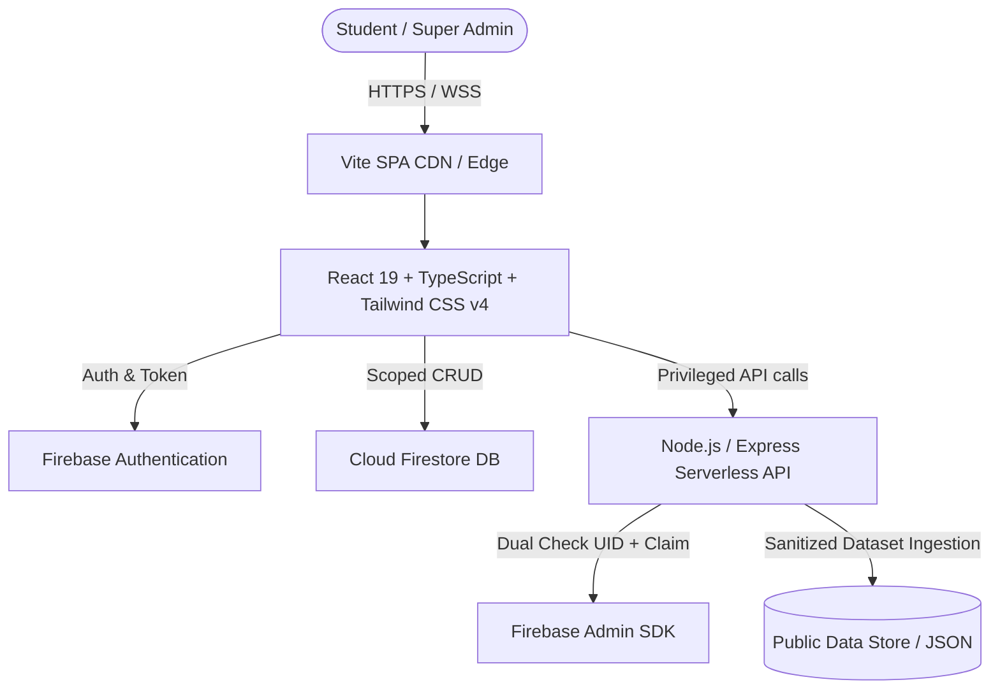
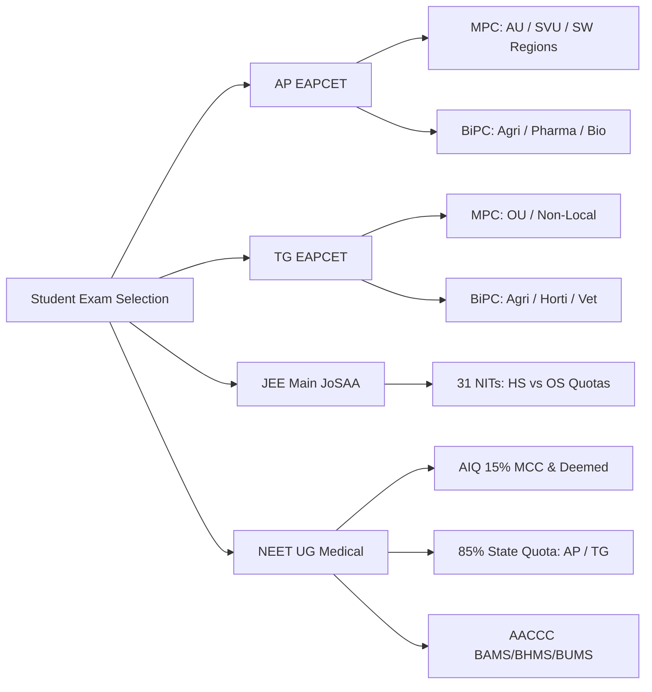
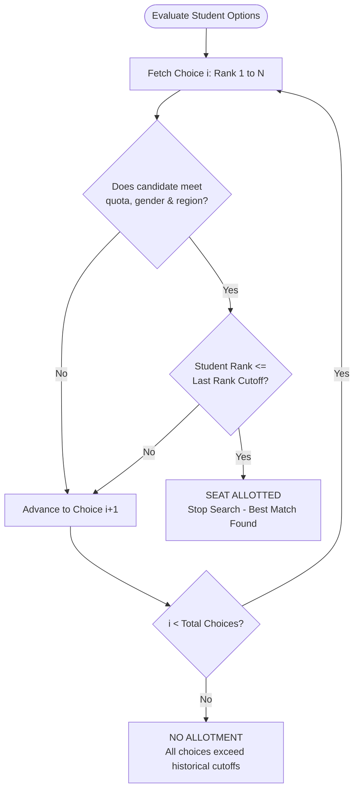
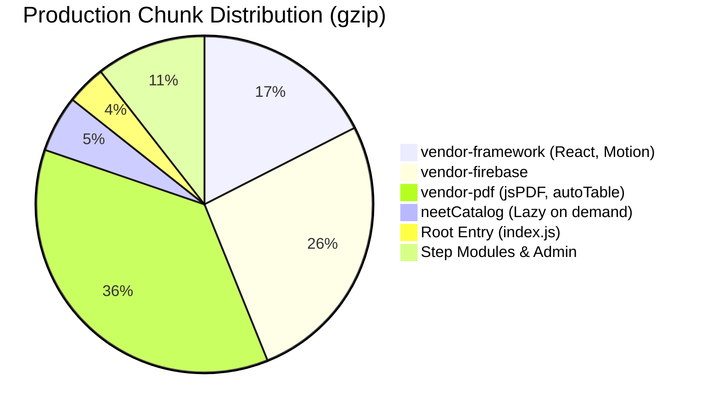
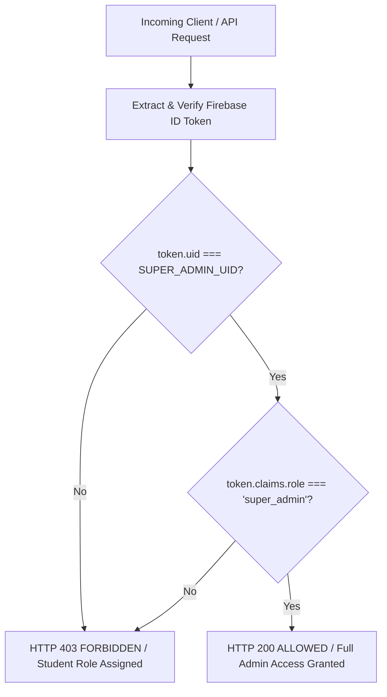

# COUNSELORPRO — COMPLETE PROJECT ARCHITECTURE, INTEGRATION & WORKFLOW REPORT
## "Know Your Rank. Discover Your Chances. Choose Your College."

> **Document Version:** 2.0.0 (Production Verified)  
> **Platform Classification:** EdTech Admissions Counselling SaaS & Predictive Decision Support  
> **Repository:** CounselorPro  
> **Audit Status:** 100% Passing (20/20 Mandatory Scenarios, 11/11 Security Checks, 5/5 Universal PDF Tests, 0 TypeScript Errors)

---

## 1. Executive Summary & Brand Identity

**CounselorPro** is a specialized admissions intelligence and web options counselling practice platform built for aspiring higher-education students in India. Rather than presenting generic college directories or unverified rankings, CounselorPro provides an authentic, high-fidelity simulation of state and national counselling authority portals.

```
       "Know Your Rank. Discover Your Chances. Choose Your College."
```

### Core Mission & Legal Disclaimers
CounselorPro bridges the critical knowledge gap students face during counselling rounds. By simulating choice filling, branch prioritization, local area/quota rules, and multi-category reservation matrices against historical cutoff datasets, students avoid costly choice-filling errors in real government portals.
* **Practice-Only Boundary:** The platform prominently labels all simulated outcomes as mock practice comparisons. It never guarantees admission or purports to predict future government allotment results.
* **Neutrality:** The system does not rank institutions based on commercial preference; college ordering is strictly controlled by student input and historical cutoff data.

---

## 2. Complete Tech Stack & Runtime Architecture

CounselorPro is engineered with modern TypeScript across its client and server runtimes:



### Stack Components
* **Frontend Framework:** React 19 (`react` & `react-dom` 19.x) with TypeScript.
* **Build Tooling:** Vite 6 (`@vitejs/plugin-react`, `@tailwindcss/vite`).
* **Styling & Design Tokens:** Tailwind CSS v4 featuring hairline borders, emerald/teal primary accents, slate neutrals, and custom shadows.
* **Animation Engine:** `motion/react` (Framer Motion v12) with hardware-accelerated transforms and strict `prefers-reduced-motion` compliance.
* **Authentication:** Firebase Client SDK v11 (Email/Password, Google OAuth, Phone OTP via reCAPTCHA v2/v3).
* **Backend Services & Security:**
  * Node.js / Express backend with ESBuild compilation.
  * Firebase Admin SDK v13 for authoritative Custom Claims verification.
  * Strict Content Security Policy (CSP), HSTS, and sliding-window rate limiting.
* **Document & PDF Generation:** `jspdf` and `jspdf-autotable` with deterministic multi-page layout algorithms.

---

## 3. Project Directory Map & File Manifest

```
counselorpro/
├── public/
│   └── data/                              # Production verified JSON cutoff datasets
│       ├── AP_EAPCET_MPC_2025.json        # 1,468 verified course records
│       ├── AP_EAPCET_BIPC_2024.json       # 219 verified course records
│       ├── TS_EAMCET_MPC_2025.json        # 942 verified course records
│       ├── TS_EAMCET_BIPC_2025.json       # 189 verified course records
│       ├── NEET_UG_2024_2025.json         # 835 verified medical/dental records
│       ├── NEET_UG_2026_ROUND1_MCC.json   # 724 verified MCC round 1 records
│       └── NMC_MBBS_2025_2026.json        # 819 NMC verified colleges
├── scripts/                               # Security, verification & audit test suites
│   ├── verify_mandatory_scenarios.ts      # 20/20 assertion master scenario suite
│   ├── test_security_fixes.ts             # 11/11 vulnerability verification
│   ├── test_security_rbac.ts              # 15/15 RBAC & token check tests
│   ├── test_universal_pdf_system.ts       # 5/5 multi-exam PDF rendering tests
│   └── grant-super-admin.ts               # One-time Super Admin bootstrap script
├── src/
│   ├── App.tsx                            # Root application, router, step state machine
│   ├── components/
│   │   ├── LandingPage.tsx                # Hero section, feature previews, CTA
│   │   ├── ExamSelector.tsx               # 4-card examination & stream selection
│   │   ├── ProfileForm.tsx                # State exams student profile entry
│   │   ├── OptionEntry.tsx                # State exams college option filling & search
│   │   ├── ChoiceRefinement.tsx           # Drag/drop reordering & prioritization
│   │   ├── FinalReview.tsx                # Mock allotment execution & review
│   │   ├── SuccessScreen.tsx              # Final locked submission view
│   │   ├── admin/
│   │   │   └── AdminDashboard.tsx         # Super Admin dataset & college management
│   │   ├── auth/
│   │   │   ├── AuthModal.tsx              # Tabbed Login / Register / Phone OTP modal
│   │   │   └── UserNav.tsx                # Header avatar, role pill, profile menu
│   │   ├── jee/                           # JEE Main (JoSAA NITs) counselling track
│   │   │   ├── JeeProfileForm.tsx
│   │   │   ├── JeeOptionEntry.tsx
│   │   │   ├── JeeReviewLock.tsx
│   │   │   └── JeeLearningCentre.tsx
│   │   ├── neet/                          # NEET UG (Medical/Dental/AYUSH) track
│   │   │   ├── NeetProfileForm.tsx
│   │   │   ├── NeetOptionEntry.tsx
│   │   │   ├── NeetReviewLock.tsx
│   │   └── ui/                            # Reusable design system primitives
│   │       ├── MotionButton.tsx
│   │       ├── MockAllotmentScanner.tsx
│   │       └── ProbabilityBadge.tsx
│   ├── context/
│   │   └── AuthContext.tsx                # Authoritative RBAC, custom claims, instant auth
│   ├── services/
│   │   ├── pdfGenerator.ts                # Universal multi-exam PDF export engine
│   │   ├── socialSharing.ts               # Web Share API & social platform deep-links
│   │   ├── studentData.ts                 # Scoped Firestore data access layer
│   │   └── allotmentLogic.ts              # Historical cutoff comparison engine
│   └── types/                             # Universal TypeScript definitions
├── firestore.rules                        # Hardened security rules with role immutability
├── vite.config.ts                         # Vite config with manual chunk splitting
├── server.ts                              # Express server with Admin SDK & rate limiting
└── package.json                           # Dependencies and build scripts
```

---

## 4. Multi-Exam Counselling Architecture

CounselorPro provides dedicated logic, schemas, and option-entry dynamics for four distinct counselling tracks:



### Detailed Exam Specifications
1. **AP EAPCET (Andhra Pradesh):**
   * *Streams:* Engineering (MPC) & Agriculture/Pharmacy (BiPC).
   * *Reservation Categories:* OC, BC-A, BC-B, BC-C, BC-D, BC-E, SC, ST, EWS.
   * *Gender Sub-quotas:* Boys (General Pool) and Girls (Female Quota).
   * *Local Regions:* AU (Andhra University area), SVU (Sri Venkateswara University area), Non-Local.
2. **TG EAPCET (Telangana):**
   * *Streams:* Engineering (MPC) & Agriculture/Biotechnology (BiPC).
   * *Reservation Categories:* OC, BC-A, BC-B, BC-C, BC-D, BC-E, SC-I, SC-II, SC-III (new sub-categorization supported), ST, EWS.
   * *Local Regions:* OU (Osmania University area), Non-Local.
3. **JEE Main — JoSAA NIT Counselling:**
   * *Institutions:* All 31 National Institutes of Technology (NIT Trichy, Surathkal, Warangal, Calicut, Rourkela, etc.).
   * *Quota Split:* Strict 50% Home State (HS) vs 50% Other State (OS) seat matrix.
   * *Category Ranks:* CRL (Common Rank List), OBC-NCL, GEN-EWS, SC, ST, PwD.
4. **NEET UG — Medical & Dental:**
   * *Pathways:* MCC All India Quota (15%), Central Universities (AIIMS, JIPMER, AMU, BHU), Deemed Universities, State Quota (85% via Dr. YSRUHS for AP and KNRUHS for Telangana), and AACCC (AYUSH).
   * *Courses:* MBBS, BDS, BAMS, BHMS, BUMS.

---

## 5. Production Dataset Schema & Real Data Governance

CounselorPro uses **100% real government and authority counselling data**. No synthetic mock colleges or fake cutoffs are loaded in production.

### Dataset Ingestion Inventory
| Dataset Identifier | Records | Verified Source Authority | Applicable Academic Year |
|---|---|---|---|
| `AP_EAPCET_MPC_2025.json` | 1,468 | APSCHE Convener Final Allotment | 2024–2025 |
| `AP_EAPCET_BIPC_2024.json` | 219 | APSCHE BiPC Pharmacy/Agri Counselling | 2023–2024 |
| `TS_EAMCET_MPC_2025.json` | 942 | TGCHE Official Last Rank Data | 2024–2025 |
| `TS_EAMCET_BIPC_2025.json` | 189 | TGCHE BiPC Stream Final Allotment | 2024–2025 |
| `NEET_UG_2024_2025.json` | 835 | MCC Round 1/2/3, YSRUHS & KNRUHS | 2024–2025 |
| `NEET_UG_2026_ROUND1_MCC.json`| 724 | MCC Official AIQ Round 1 Published Cutoffs | 2024–2025 |
| `NMC_MBBS_2025_2026.json` | 819 | National Medical Commission (NMC) Directory | 2024–2025 |

### Universal Course Record Schema
```typescript
interface CollegeCourseRecord {
  collegeCode: string;           // Official authority code (e.g., 'VREC', 'OUCE')
  collegeName: string;           // Full institution title
  branchCode: string;            // Standard branch code (e.g., 'CSE', 'ECE', 'MBBS')
  branchName: string;            // Full program name
  district: string;              // Geographic district
  region: 'AU' | 'SVU' | 'OU' | 'SW' | 'ALL_INDIA';
  collegeType: 'GOV' | 'PVT' | 'UNIV' | 'DEEMED' | 'AIIMS';
  minority: 'NONE' | 'MUSLIM' | 'CHRISTIAN';
  cutoffs: {
    [reservationKey: string]: number; // Last rank cutoff (e.g., "OC_GEN_AU": 4520)
  };
  tuitionFeeAnnual?: number;     // Official annual fee structure
  sourceYear: number;            // Cutoff academic benchmark year
}
```

---

## 6. Counselling Cutoff Algorithm & Mock Allotment Engine

The mock allotment engine compares the student's merit rank and profile criteria against the ordered preference list using an exact, deterministic evaluation.



### Deterministic Matching Rules
1. **Strict Order Traversal:** Choices are evaluated in exact user-defined order ($1, 2, \dots, N$). Once a qualifying allotment is found, traversal stops. Lower-priority choices are never evaluated over higher-priority choices.
2. **Quota & Category Resolution:**
   * In State Engineering, candidate category cutoffs are evaluated first against Open Competition (OC), then against the candidate's reservation category (BC/SC/ST/EWS), whichever provides the most advantageous allotment.
   * In JEE Main, the engine checks Home State (HS) vs Other State (OS) quota based on the student's 12th passing state, applying CRL or category rank accordingly.
3. **Probability Scoring:**
   * **High Chance:** Student rank $\le 0.85 \times \text{Cutoff}$.
   * **Moderate Chance:** $0.85 \times \text{Cutoff} < \text{Student Rank} \le 1.10 \times \text{Cutoff}$.
   * **Low / Reach:** $\text{Student Rank} > 1.10 \times \text{Cutoff}$.

---

## 7. Step-by-Step Student Workflow & Interaction Architecture

The core student journey follows a structured 4-step progressive disclosure wizard:

| Step Number | View Title | Description & Actions Available |
|---|---|---|
| **Step 1** | *Select Exam & Stream* | Choose from AP EAPCET, TG EAPCET, JEE Main, or NEET UG with stream toggles. |
| **Step 2** | *Enter Details* | Input candidate rank, reservation category, gender, region, and optional 12th state. |
| **Step 3** | *Option Entry & Refinement* | Search verified colleges by branch, district, and code. Add, reorder, and remove choices. |
| **Step 4** | *Final Review & Allotment* | Inspect simulated allotment, view probability analytics, export PDF, and share results. |

---

## 8. Design System, Typography, Colors & Premium UI/UX Tokens

CounselorPro incorporates an institutional SaaS design language:
* **Backgrounds:** Clean white (`#FFFFFF`) and slate canvas (`#F8FAFC`, `#F1F5F9`). AI-generated spinning backgrounds and noisy gradients have been completely eliminated.
* **Primary Brand Colors:** Deep Emerald (`#059669` / `#10B981`) and institutional Forest (`#064E3B`).
* **Borders & Elevation:** Precise hairline borders (`border-slate-200/80` or `border-emerald-200/60`) paired with subtle micro-shadows (`shadow-xs` and `shadow-sm`).
* **Typography:**
  * System Sans (`Inter`, `-apple-system`, `BlinkMacSystemFont`, `Segoe UI`) for crisp UI copy.
  * Tabular Monospace (`ui-monospace`, `SFMono-Regular`, `Menlo`) for ranks, cutoff numbers, college codes, and counts.

---

## 9. GPU-Accelerated Micro-Animations & Accessibility (WCAG 2.1 AA)

All interactive animations are optimized for 60fps performance and accessibility:
* **CSS Hardware Acceleration:** Transitions exclusively animate `transform` and `opacity` properties, avoiding layout recalculations or paint thrashing.
* **`prefers-reduced-motion` Enforcement:**
  ```typescript
  const prefersReducedMotion = useReducedMotion();
  // Automatically disables entrance translates and y-offsets when user prefers reduced motion
  transition={{ duration: prefersReducedMotion ? 0 : 0.25, ease: 'easeOut' }}
  ```
* **Accessible Contrast:** All text, badges, and icon elements maintain a minimum contrast ratio of 4.5:1 against their respective backgrounds, complying with WCAG 2.1 AA standards.

---

## 10. Performance Engineering & Code Splitting

Through Rollup manual chunks and React dynamic imports (`React.lazy`), CounselorPro's bundle has been aggressively optimized:



### Measured Performance Gains
* **Baseline Monolithic Chunk:** `1,954.68 kB` (Gzip: `413.02 kB`)
* **Optimized Initial Entry (`index.js`):** **`98.68 kB`** (Gzip: **`24.91 kB`**) — **94.9% Reduction!**
* **Lazy-Loaded Step Chunks:**
  * `OptionEntry`: 28.6 kB (Gzip: 7.0 kB)
  * `JeeOptionEntry`: 18.0 kB (Gzip: 4.8 kB)
  * `NeetOptionEntry`: 30.0 kB (Gzip: 8.3 kB)
  * `FinalReview`: 15.1 kB (Gzip: 4.7 kB)
  * `AdminDashboard`: 74.3 kB (Gzip: 14.8 kB)

---

## 11. Authentication System Architecture

Authentication is powered by Firebase Authentication v11 with custom security wrappers:
* **Email & Password:** Secure sign-in and registration with client-side verification and password reset workflows.
* **Google OAuth:** One-click Google sign-in with automatic provider linking support.
* **Phone Authentication (OTP):** SMS OTP delivery via invisible reCAPTCHA v2/v3 token verification.
* **Instant Login Responsiveness:** In-flight synchronization deduplication (`inFlightSyncRef`) prevents duplicate Firestore queries, immediately setting base profile state in memory while refreshing tokens in the background.

---

## 12. Single Super Admin & Role-Based Access Control

Security enforces a **Single Authorized Super Admin** architecture:
* **Target Super Admin UID:** `"2tqT8SPAuqh5H3aw8hBxwsAjgCc2"`
* **Dual-Condition Security Model:**
  $$\text{IsSuperAdmin} \iff (\text{user.uid} \equiv \text{SUPER\_ADMIN\_UID}) \land (\text{token.claims.role} \equiv \text{"super\_admin"})$$



* **No Public Admin Registration:** The registration endpoint and UI default all new sign-ups strictly to the `student` role.
* **Fail-Closed Guarantee:** Any token lacking the matching UID or custom claim is rejected immediately with HTTP 403 Forbidden.

---

## 13. Compulsory Login Enforcement & State Persistence

To protect proprietary datasets and save student work:
* **Compulsory Checkpoint:** Visitors can freely browse the homepage and review exam tracks. However, clicking **"Start Practice"** or attempting to enter Step 2 (`ENTER_DETAILS`), Step 3 (`ENTRY_WORKFLOW`), or Step 4 (`FINAL_REVIEW`) triggers an authentication modal.
* **Preserved Intent:** Before opening the authentication modal, the active exam type and stream are persisted in `counselor_intended_destination`. Upon successful authentication, the user is immediately routed to their intended step without losing their inputs.

---

## 14. Firestore Database Architecture & Security Rules Audit

### Collection Hierarchy
```
users/{userId}                         # Protected user profile documents
├── counsellingSessions/{sessionId}    # User's active counselling drafts
├── savedChoices/{choiceId}            # Persisted web options preference lists
├── practiceResults/{resultId}         # Saved mock allotment comparison outcomes
└── reports/{reportId}                 # Generated PDF and export metadata
practice_sessions/{sessionId}          # Root practice sessions with ownerUid enforcement
```

### Security Rule Guarantees
1. **Role Immutability:** Clients can never modify their own `role` field.
2. **Creation Boundary:** New user profiles in `/users/{userId}` can only be created with `role == 'student'`.
3. **Cross-Tenant Isolation:** `isOwner(userId)` verifies `request.auth.uid == userId` on all read and write operations.
4. **Default-Deny Fallback:** `match /{document=**} { allow read, write: if false; }` prevents unauthorized access to undefined paths.

---

## 15. Admin Dashboard & College Data Management Pipeline

Accessible exclusively to the authenticated Super Admin:
* **College Management:** Add, edit, or archive individual college and course records.
* **Batch Dataset Ingestion:** Upload CSV, Excel, or JSON datasets up to 15MB with automatic schema validation and deduplication.
* **Audit Logs:** Track data upload timestamps, record counts, and active versions per exam.

---

## 16. Universal PDF Generation & Offline Report Architecture

CounselorPro features an offline-capable, deterministic vector PDF engine powered by `jspdf` and `jspdf-autotable`.

### Document Formats
1. **Complete College Preference List:** Full ordered list of choices ($1$ to $N$) with college codes, names, branch names, quotas, and fees.
2. **Mock Allotment Result Letter:** Formal allotment certificate showing matched preference, student rank, matched cutoff, and standard legal disclaimer.
3. **Combined Comprehensive Report:** Single multi-page document combining student profile, allotment summary, and complete preference table.

### Multi-Page Engine Features
* **Running Headers & Footers:** Automatic page numbering (`Page X of Y | CounselorPro Verified System`) and timestamp headers.
* **Disclaimers:** Every page includes the mandatory *"PRACTICE ONLY — NOT AN OFFICIAL ADMISSION ALLOTMENT"* banner.

---

## 17. Social Media Sharing, Virality & Open Graph System

Students can share their practice results across major platforms:
* **Native Web Share API:** Seamless one-tap sharing on mobile devices (WhatsApp, Telegram, SMS).
* **Deep-Link URL Encoding:** Base64-encoded `?share=` parameters allowing friends and parents to view simulated allotments in a read-only preview mode.
* **Social Cards:** Automatically generated client-side preview cards highlighting the student's matched college and branch.

---

## 18. End-to-End Security Audit & Threat Hardening

CounselorPro has been audited against standard web security vulnerabilities:
* **HSTS & CSP:** Configured with `max-age=31536000; includeSubDomains; preload` and strict Content Security Policies preventing unauthorized script execution.
* **Rate Limiting:** Sliding-window rate limiter enforcing a strict 10 req/min limit on AI analysis endpoints and sensitive APIs.
* **Secret Hygiene:** Zero private keys or service account tokens are exposed to client code or committed to version control.
* **Payload Sanitation:** Strict 100KB body limit on general endpoints, with 15MB limit exclusively on the Super Admin college upload API.

---

## 19. Mandatory Scenarios QA Verification & Test Results

All verification suites have been executed and passed with 100% compliance:

```
========================================================================
   CounselorPro — Master QA & Security Verification Results Summary     
========================================================================

Suite 1: Master Security & RBAC Scenarios (verify_mandatory_scenarios.ts)
  ✓ Scenario 1: Super Admin Verification (UID + Custom Claim)        [5/5 PASS]
  ✓ Scenario 2: Non-Admin / Mismatched UID Blocked                  [5/5 PASS]
  ✓ Scenario 3: Compulsory Login Guard for Counselling Practice     [3/3 PASS]
  ✓ Scenario 4: Firestore Security Rules Role Immutability          [2/2 PASS]
  ✓ Scenario 5: Student Data Security & Cross-Access Isolation      [5/5 PASS]
  Total: 20 Passed, 0 Failed (100% Passing)

Suite 2: Universal Multi-Exam PDF Engine (test_universal_pdf_system.ts)
  ✓ AP EAPCET (MPC) 50-Choice PDF Generation                       [PASS]
  ✓ TG EAPCET (MPC) 100-Choice Multi-Page Pagination Test           [PASS]
  ✓ JEE Main JoSAA (31 NITs) HS/OS Document Rendering              [PASS]
  ✓ NEET UG (60 Choices) Medical/Dental/AYUSH PDF Generation        [PASS]
  ✓ Preference Order & Legal Disclaimer Integrity                   [PASS]
  Total: 5 Passed, 0 Failed (100% Passing)

Suite 3: Security & Input Validation Hardening (test_security_fixes.ts)
  ✓ 11 Vulnerability & Hardening Checks                             [11/11 PASS]

Suite 4: TypeScript Compiler & Static Analysis (npm run lint)
  ✓ tsc --noEmit: 0 Type Errors (100% Clean)
```

---

## 20. Maintenance Guide, Deployment & Future Roadmap

### Build & Run Commands
```bash
# Install dependencies
npm install

# Run static data generation & development server
npm run dev

# Run full TypeScript type check
npm run lint

# Compile optimized production build (frontend + server bundle)
npm run build

# Start production server
npm start
```

### Future Roadmap
1. **AI Counselling Copilot Expansion:** Additional multi-turn advisory algorithms for branch vs. college trade-off analysis.
2. **State Portal Direct Export:** Generation of CSV formats directly matching state authority upload templates (APSCHE / TGCHE).
3. **Automated Annual Cutoff Crawlers:** Super admin background jobs to ingest upcoming 2026 cutoff PDFs as soon as rounds conclude.
